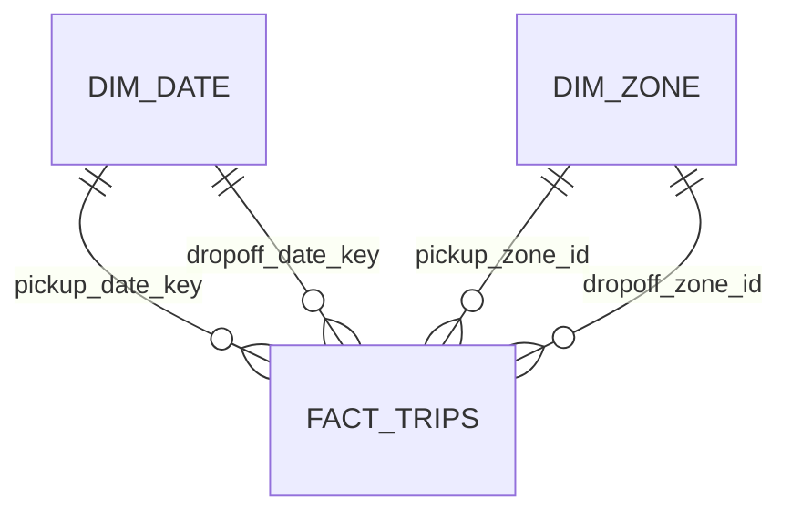

# NYC Yellow Taxi Dimensional Model

## 1. Business process

`fact_trips` mô hình hóa quá trình ghi nhận một Yellow Taxi trip record, từ lúc taximeter được bật đến lúc taximeter được tắt. Dữ liệu do technology provider gửi cho NYC TLC nên một record không được xem là bằng chứng tuyệt đối về một chuyến duy nhất ngoài thực tế.

Mỗi accepted record giữ thời gian, khu vực đón/trả, số hành khách, quãng đường, thời lượng, phương thức thanh toán và các khoản tiền được ghi nhận. Business process này hỗ trợ phân tích số chuyến, nhu cầu di chuyển, recorded revenue, tip, thời lượng và quãng đường theo thời gian và khu vực.

## 2. Grain declaration

> Mỗi dòng trong `fact_trips` đại diện cho một accepted Yellow Taxi trip record do technology provider gửi cho NYC TLC.

Grain này được khai báo trước khi chọn dimension và measure. Không lưu KPI đã tổng hợp theo ngày, tháng hoặc zone trong `fact_trips`, vì các KPI đó có grain khác với một trip record.

## 3. Bus matrix

`dim_date` và `dim_zone` là role-playing dimensions: mỗi dimension vật lý được dùng ở nhiều vai trò trong cùng business process.

| Business process | Pickup date | Dropoff date | Pickup zone | Dropoff zone |
| --- | ---: | ---: | ---: | ---: |
| Yellow Taxi trip | X | X | X | X |

## 4. Logical schemas

### 4.1 `fact_trips`

| Column | Type | Nullable | Logical role | Meaning/derivation |
| --- | --- | --- | --- | --- |
| `trip_id` | `STRING` | No | Logical PK / degenerate identifier | Deterministic SHA-256 fingerprint; uniqueness do pipeline kiểm tra |
| `vendor_id` | `INT` | No | Categorical attribute | Canonical input |
| `pickup_at` | `TIMESTAMP` | No | Event timestamp | Thời điểm bắt đầu record |
| `dropoff_at` | `TIMESTAMP` | No | Event timestamp | Thời điểm kết thúc record |
| `pickup_date_key` | `INT` | No | FK → `dim_date.date_key` | `yyyyMMdd` từ `pickup_at` |
| `dropoff_date_key` | `INT` | No | FK → `dim_date.date_key` | `yyyyMMdd` từ `dropoff_at` |
| `pickup_date` | `DATE` | No | Derived/partition attribute | Date component của `pickup_at`; candidate physical partition column |
| `dropoff_date` | `DATE` | No | Derived attribute | Date component của `dropoff_at` |
| `pickup_hour` | `TINYINT` | No | Categorical attribute | Hour 0–23 từ `pickup_at` |
| `pickup_zone_id` | `INT` | No | FK → `dim_zone.zone_id` | Canonical pickup zone |
| `dropoff_zone_id` | `INT` | No | FK → `dim_zone.zone_id` | Canonical dropoff zone |
| `passenger_count` | `INT` | Yes | Measure | Số hành khách được source ghi nhận; null không đổi thành 0 |
| `trip_distance_miles` | `DECIMAL(12,2)` | No | Measure | Quãng đường taximeter ghi nhận |
| `duration_minutes` | `DECIMAL(12,2)` | No | Measure | (`dropoff_at - pickup_at`) / 60 seconds |
| `rate_code_id` | `INT` | Yes | Categorical attribute | Canonical input |
| `payment_type_id` | `INT` | No | Categorical attribute | Canonical input |
| `store_and_fwd_flag` | `STRING` | Yes | Categorical attribute | `Y`, `N` hoặc null theo contract |
| `fare_amount` | `DECIMAL(12,2)` | No | Additive measure | Canonical input |
| `extra_amount` | `DECIMAL(12,2)` | No | Additive measure | Canonical input |
| `mta_tax_amount` | `DECIMAL(12,2)` | No | Additive measure | Canonical input |
| `tip_amount` | `DECIMAL(12,2)` | No | Additive measure | Không đại diện đầy đủ cash tips |
| `tolls_amount` | `DECIMAL(12,2)` | No | Additive measure | Canonical input |
| `improvement_surcharge_amount` | `DECIMAL(12,2)` | No | Additive measure | Canonical input |
| `congestion_surcharge_amount` | `DECIMAL(12,2)` | Yes | Additive measure | Canonical input; nullable không tự đổi thành 0 |
| `airport_fee_amount` | `DECIMAL(12,2)` | Yes | Additive measure | Canonical input; nullable không tự đổi thành 0 |
| `cbd_congestion_fee_amount` | `DECIMAL(12,2)` | Yes | Additive measure | Canonical input |
| `total_amount` | `DECIMAL(12,2)` | No | Additive measure | Tổng tiền được record ghi nhận; không phải doanh thu kế toán |
| `warning_rule_ids` | `ARRAY<STRING>` | No | Quality metadata | Tất cả matching `WARN` rule IDs; empty array nếu không có |
| `processing_month` | `STRING` | No | Audit/partition metadata | Pipeline argument, format `yyyy-MM` |
| `contract_version` | `STRING` | No | Audit metadata | Contract áp dụng cho record |
| `processed_at` | `TIMESTAMP` | No | Audit metadata | Pipeline processing timestamp |

`pickup_date` được giữ cùng `pickup_date_key` vì hai cột có mục đích khác nhau: key dùng join dimension, còn date là candidate partition column giúp query engine lọc đường dẫn dữ liệu. Việc partition vật lý chỉ được chốt sau benchmark.

### 4.2 `dim_date`

Grain: một dòng đại diện cho một ngày dương lịch.

| Column | Type | Nullable | Logical role | Meaning/derivation |
| --- | --- | --- | --- | --- |
| `date_key` | `INT` | No | Logical PK | `yyyyMMdd`, ví dụ `20250131` |
| `calendar_date` | `DATE` | No | Alternate key | Calendar date, unique |
| `year` | `SMALLINT` | No | Attribute | Calendar year |
| `quarter` | `TINYINT` | No | Attribute | 1–4 |
| `month` | `TINYINT` | No | Attribute | 1–12 |
| `month_name` | `STRING` | No | Attribute | English month name |
| `day` | `TINYINT` | No | Attribute | Day of month |
| `day_of_week` | `TINYINT` | No | Attribute | ISO convention: Monday = 1, ..., Sunday = 7 |
| `day_name` | `STRING` | No | Attribute | English day name |
| `is_weekend` | `BOOLEAN` | No | Attribute | `true` khi `day_of_week IN (6,7)` |

Phạm vi ngày phải bao phủ ít nhất mọi `pickup_at` và `dropoff_at` của các tháng được xử lý. MVP có thể sinh một phạm vi cố định có tài liệu hóa; production cần bảo đảm phạm vi này tự mở rộng an toàn.

### 4.3 `dim_zone`

Grain: một dòng đại diện cho một TLC taxi zone.

| Column | Type | Nullable | Logical role | Meaning/derivation |
| --- | --- | --- | --- | --- |
| `zone_id` | `INT` | No | Logical PK / natural key | Rename có chủ đích từ source `LocationID` |
| `borough` | `STRING` | No | Attribute | Zone lookup |
| `zone_name` | `STRING` | No | Attribute | Source column `Zone` |
| `service_zone` | `STRING` | Yes | Attribute | Source column `service_zone` |

`zone_id` dùng trực tiếp natural key của TLC vì lookup hiện có 265 `LocationID` duy nhất, chưa có yêu cầu lưu lịch sử thay đổi và fact source cũng tham chiếu cùng ID. Nếu sau này cần Slowly Changing Dimension hoặc hợp nhất nhiều hệ thống có key xung đột, có thể thêm surrogate `zone_key` trong phiên bản model mới.

## 5. Relationships



- `pickup_date_key` và `dropoff_date_key` cùng tham chiếu `dim_date.date_key` với hai vai trò khác nhau.
- `pickup_zone_id` và `dropoff_zone_id` cùng tham chiếu `dim_zone.zone_id` với hai vai trò khác nhau.
- Không tạo `dim_pickup_zone` và `dim_dropoff_zone` vì chúng sẽ lặp lại cùng 265 zone và làm model phức tạp mà không bổ sung insight.
- S3 Parquet và Athena external tables không cưỡng chế primary/foreign keys. Spark validation và automated tests phải bảo đảm uniqueness và referential integrity trước khi publish curated output.

Required relationship invariants:

```text
count(fact_trips) = count(distinct trip_id)
every pickup_date_key exists in dim_date
every dropoff_date_key exists in dim_date
every pickup_zone_id exists in dim_zone
every dropoff_zone_id exists in dim_zone
```

## 6. Measure behavior

Không phải mọi cột numeric đều là measure. Một cột là measure khi nó biểu diễn đại lượng định lượng tại đúng grain của fact và có ý nghĩa trong phép tổng hợp phù hợp.

| Measure | Aggregation guidance |
| --- | --- |
| Các amount fields | Có thể `SUM` qua accepted trip records; nullable components không tự biến thành 0 khi tính reconciliation |
| `trip_distance_miles` | Có thể `SUM`; `AVG`, median và p95 thường hữu ích hơn cho trip analysis |
| `duration_minutes` | Có thể `SUM`, nhưng `AVG`, median và p95 thường có ý nghĩa phân tích hơn |
| `passenger_count` | Có thể `SUM` trên non-null values; phải công bố null count/coverage |

`vendor_id`, `rate_code_id`, `payment_type_id` và `pickup_hour` là numeric về kiểu lưu trữ nhưng là categorical attributes, không được cộng.

## 7. Design decisions

### 7.1 Vì sao grain là một accepted trip record?

Fact table lưu measurement events của business process. Dự án cần phân tích số chuyến, recorded revenue, thời lượng, quãng đường và nhu cầu theo vùng/thời gian, nên atomic accepted trip record là grain thấp nhất phù hợp. Grain này cho phép tổng hợp linh hoạt mà không nhúng sẵn KPI ở grain ngày hoặc tháng.

### 7.2 Vì sao không tạo `dim_pickup_zone` và `dim_dropoff_zone`?

Pickup và dropoff dùng cùng tập TLC zones và cùng thuộc tính mô tả. Một `dim_zone` đã cung cấp đầy đủ insight; fact tham chiếu nó bằng hai foreign keys theo role. Hai bảng riêng sẽ lặp dữ liệu và tăng độ phức tạp đồng bộ.

### 7.3 Vì sao dùng `LocationID` làm key cho `dim_zone`?

Pipeline không đổi `LocationID` thành tên bảng; nó **đổi tên cột** `LocationID` thành `zone_id`. `zone_id` vẫn là natural key do TLC cung cấp. Natural key này phù hợp cho MVP vì unique trong lookup, ổn định trong phạm vi dữ liệu hiện tại và được raw fact tham chiếu trực tiếp. Surrogate key chỉ cần khi có lịch sử zone, nhiều source systems hoặc key collision.

### 7.4 Vì sao chưa tạo `dim_time`?

`dim_date` không thay thế `dim_time`: date mô tả ngày, còn time mô tả giờ/phút trong ngày. Tuy nhiên, MVP chỉ cần `pickup_hour` 0–23 và chưa có nhiều thuộc tính thời gian dùng lại như shift, peak band hoặc business-hour calendar. Vì vậy giữ `pickup_hour` trong fact đơn giản và đủ cho nhu cầu hiện tại; có thể thêm `dim_time` khi xuất hiện use case thực tế.

### 7.5 Vì sao `trip_id` không có `dim_trip`?

`trip_id` là deterministic fingerprint dùng để nhận diện, deduplicate và audit record. Nó không có tập thuộc tính mô tả độc lập tạo giá trị phân tích, nên một `dim_trip` chỉ tạo quan hệ 1–1 không cần thiết. Trong fact, nó đóng vai trò degenerate identifier/logical primary key.

### 7.6 Vì sao tiền và duration là measures?

Không phải chỉ vì chúng có kiểu số. Chúng là measures vì biểu diễn đại lượng định lượng của đúng một trip record và có thể được tổng hợp có ý nghĩa, ví dụ tổng recorded amount hoặc trung bình/p50/p95 duration. Ngược lại, `payment_type_id` cũng là số nhưng chỉ là category code.

### 7.7 KPI được định nghĩa và tính ở đâu?

Định nghĩa nghiệp vụ của KPI nằm trong Section 9 của `data_contract.md`, ví dụ `trip_count`, `recorded_revenue` và duration metrics. `fact_trips` chỉ lưu atomic measures. Athena SQL hoặc semantic/dashboard layer sẽ tính KPI từ fact theo dimensions.

Không lưu `daily_revenue`, `monthly_trip_count` hoặc `average_duration_by_zone` trong trip-level fact vì chúng có grain khác. Nếu lặp KPI ngày trên từng trip, query `SUM` sẽ double count. Khi performance yêu cầu, có thể tạo aggregate fact/data mart riêng, ví dụ `fact_daily_zone_metrics`, với grain được khai báo độc lập.

### 7.8 Referential integrity được bảo đảm thế nào?

S3 chỉ lưu objects và Athena external tables chủ yếu cung cấp metadata/query engine; chúng không enforce foreign keys như OLTP database. Trước khi publish curated data, Spark job phải anti-join fact keys với dimensions và fail/quarantine theo contract. Automated tests tiếp tục kiểm tra uniqueness, null keys và orphan keys. Quality metrics lưu kết quả để vận hành và audit.

## 8. Deferred extensions

Các dimension sau chưa thuộc MVP:

- `dim_time`: chỉ thêm khi có reusable time bands hoặc minute-level analysis.
- `dim_payment_type`, `dim_rate_code`, `dim_vendor`: cân nhắc khi cần quản lý mô tả/history tập trung hoặc dùng chung giữa nhiều fact tables.
- Surrogate key/SCD cho `dim_zone`: chỉ thêm khi zone attributes thay đổi theo thời gian hoặc tích hợp nhiều source.
- Aggregate fact/data mart: chỉ thêm sau khi đo latency và Athena bytes scanned trên atomic fact.
